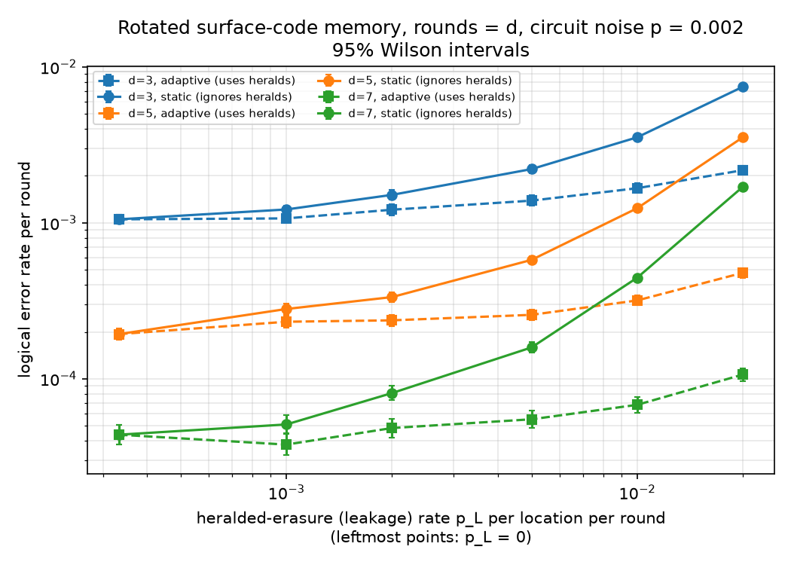

# Adaptive decoding under heralded leakage

A small simulation study: **if a surface-code decoder is told *where* a qubit leaked, how much does that help?**

Leakage (a superconducting qubit escaping into |2⟩ or higher) is one of the error types Riverlane's
Local Clustering Decoder paper ([arXiv:2411.10343](https://arxiv.org/abs/2411.10343)) targets with an
*adaptive* decoder. This repo asks a deliberately simpler version of that question on a laptop-sized budget:

* Leakage is modelled as **heralded erasure** (Stim's `HERALDED_ERASE`): with probability `p_L` a qubit
  suffers a uniformly random Pauli (I, X, Y or Z) and a flag bit tells us *where and when* it happened.
  **This is a simplified proxy for leakage, not leakage.** Real leakage persists for several rounds, spreads
  through two-qubit gates and is detected late and imperfectly. None of that is modelled here.
* Two decoders see exactly the same shots:
  **static** PyMatching, which ignores the flags, and **adaptive** PyMatching, which uses them shot by shot.
* There is also a C++ union-find decoder with erasure support (`hw/`), timed against a 1 µs-per-round budget.



*Headline plot (`results/ler_vs_leak.png`): logical error per round against heralded-erasure rate, at d = 3, 5, 7.
Circuit noise is p = 2×10⁻³. Error bars are 95% Wilson intervals. Solid lines are static, dashed are adaptive.*

## Results (all from `results/`, produced by one run of `leakdecode-bench`)

The full run takes **about 8 minutes** (490 s here) on an 8-core x86-64 cloud VM with 6 worker processes.
The Monte Carlo sweep took 353 s of that. Every number below is copied from the CSVs in `results/`.

**1. Using the heralds keeps the code below threshold-like scaling as leakage grows.**
Logical error rate per round at d = 7 (600,000 shots per point; both decoders decode the same shots):

| p_L | static (ignores heralds) | adaptive (uses heralds) | static / adaptive |
|---|---|---|---|
| 0 | 4.38e-05 (184 errors) | 4.38e-05 (184) | 1.0 |
| 1×10⁻³ | 5.10e-05 (214) | 3.79e-05 (159) | 1.3 |
| 5×10⁻³ | 1.59e-04 (667) | 5.50e-05 (231) | 2.9 |
| 1×10⁻² | 4.45e-04 (1864) | 6.81e-05 (286) | 6.5 |
| 2×10⁻² | 1.70e-03 (7080) | 1.06e-04 (447) | 16.0 |

At p_L = 0 the two decoders are the same matcher, so they agree exactly, which is a built-in sanity check.
At d = 7, p_L = 1×10⁻³ the adaptive point sits slightly below the p_L = 0 point. That is within the error bars
(3.24e-05–4.42e-05 against 3.79e-05–5.06e-05) and is statistical noise, not a real effect.
Every point, with shots, errors and intervals, is in `results/ler_sweep.csv`.

**2. Error suppression factor Λ** (fitted from d = 3, 5, 7; ε_round ∝ Λ^(−d/2), `results/fits.csv`):

| p_L | 0 | 1×10⁻³ | 2×10⁻³ | 5×10⁻³ | 1×10⁻² | 2×10⁻² |
|---|---|---|---|---|---|---|
| static | 5.07 | 4.71 | 4.35 | 3.74 | 2.82 | 2.09 |
| adaptive | 5.07 | 5.05 | 5.03 | 5.10 | 5.01 | 4.52 |

With the heralds, Λ barely moves up to p_L = 10⁻². Without them, it falls steadily.

**3. Qubit saving at a target logical error** (`results/qubit_savings.csv`, `results/qubit_savings.png`).
These are **extrapolated** from the three-point fits, out to distances far beyond those simulated. They are an
illustration of what the Λ values imply, not a measurement.
The ratio is qubits(static) / qubits(adaptive) for a rotated patch, n = 2d² − 1. It is given for continuous d, which is smooth, and for d rounded up to the next odd integer, which gives real patch sizes but jumps around. The fits have no error bars, so neither column carries an uncertainty.

| p_L | target 10⁻⁶ per d-round window (paper's definition) | same, odd d (real patches) | target 10⁻⁹ per round |
|---|---|---|---|
| 1×10⁻³ | 1.11× | 1.29× (d = 17 → 15) | 1.09× |
| 2×10⁻³ | 1.23× | 1.00× (d = 17 → 17) | 1.21× |
| 5×10⁻³ | 1.59× (d ≈ 19.1 → 15.2) | 1.53× (d = 21 → 17) | 1.53× |
| 1×10⁻² | 2.57× (d ≈ 25.0 → 15.6) | 2.16× (d = 25 → 17) | 2.39× |
| 2×10⁻² | 4.78× (d ≈ 37.0 → 16.9) | 4.74× (d = 37 → 17) | 4.23× |

**How this compares with the LCD paper's "~4× fewer qubits".** The paper reports d = 33 → 17 at a 10⁻⁶ error per
d×d×d window, under SI1000 noise with p = p_leak = 5×10⁻⁴, comparing *its own* adaptive and non-adaptive LCD.
We only reach a ~4–5× ratio at p_L = 2×10⁻², which is **ten times** our Pauli rate. At p_L equal to the Pauli rate
(2×10⁻³) we see about 1.23×. So this study does **not** reproduce the paper's number, and it is not a
like-for-like test of it. The differences are:
* the leakage model (instantaneous heralded erasure here; persistent, spreading leakage with leakage-reduction units there);
* the noise model (uniform depolarising here; SI1000 there);
* the decoder (MWPM here; LCD, a hardware clustering decoder, there);
* the method (extrapolation from d ≤ 7 here; fits over simulated curves up to d = 17 there).

The direction of the effect matches the paper, and the size of the effect depends heavily on the model.
See `docs/LCD_PAPER_NOTES.md`.

**4. Decode time per round** (single core, `results/decode_timing.csv`, p_L = 5×10⁻³). These are software times on a
cloud CPU, not hardware latencies.

| d | static PyMatching, `decode_batch` | adaptive PyMatching, Python reweight loop | C++ union-find, erasure-aware (mean / worst shot) |
|---|---|---|---|
| 3 | 0.04 µs | 2.86 µs | 0.07 / 1.1 µs |
| 5 | 0.21 µs | 29 µs | 0.23 / 2.4 µs |
| 7 | 0.53 µs | 93 µs | 0.47 / 3.5 µs |
| 9 | – | – | 0.80 / 5.4 µs |
| 11 | – | – | 1.21 / 5.6 µs |

The adaptive PyMatching path is slow because my driver edits PyMatching's graph from Python once per heralded shot.
That cost comes from the implementation, not from adaptive decoding as such. The C++ union-find takes the herald mask
directly, and it costs about the same with or without heralds.

**5. C++ union-find (hardware-style add-on, `hw/`).** The decoder is integer-only, unweighted, and uses arrays that are
allocated once, so nothing is allocated in the decode loop. It treats heralded edges as already grown
(Delfosse–Zémor erasure decoding). It is checked against PyMatching on the same 20,000 shots per distance at p_L = 0.005
(`results/hw_uf.csv`):

| d | UF errors, erasure-aware | PyMatching adaptive errors | agreement | UF errors, ignoring heralds | PyMatching static errors | decoder memory |
|---|---|---|---|---|---|---|
| 3 | 95 | 74 | 99.83% | 155 | 122 | 3.4 KiB |
| 5 | 36 | 25 | 99.87% | 85 | 56 | 20.0 KiB |
| 7 | 18 | 10 | 99.91% | 44 | 17 | 60.5 KiB |
| 9 | 8 | 2 | 99.97% | 38 | 12 | 135.2 KiB |
| 11 | 2 | 1 | 99.99% | 10 | 5 | 254.9 KiB |

As expected for an unweighted union-find, it makes more logical errors than matching does. Using the heralds still
cuts its errors in every row. The mean time per round on one CPU core stays under 1 µs up to d = 9 and goes above it at
d = 11. The worst single shot is several µs per round from d = 5 up. On a CPU this decoder therefore does **not** meet
a hard 1 µs-per-round budget. It decodes a whole d-round block at once rather than streaming, and a CPU time is not an
FPGA latency. `hw/FPGA_NOTE.md` sketches how the decoder would map onto an FPGA. There is no RTL.

## Method

* **Circuit.** `stim.Circuit.generated("surface_code:rotated_memory_z")`, with rounds = d and d ∈ {3, 5, 7}.
  Stim's four standard circuit-noise knobs are all set to p = 2×10⁻³: depolarising after every Clifford gate, depolarising on data
  before each round, and bit-flips before measurement and after reset.
  p = 2×10⁻³ is about 5× below the usual ~1% matching threshold, so suppression with d is clear. It is also high enough
  that d = 7 gives hundreds of logical failures in 600,000 shots, which makes the run feasible in minutes. (At 10⁻³,
  d = 7 would need roughly ten times more shots.)
* **Leakage proxy.** `HERALDED_ERASE(p_L)` is applied on every data qubit at the start of every round and on every
  measure qubit just before it is measured. The detector record offsets are remapped
  (`src/leakdecode/circuits.py`). Both locations are on by default. `--leak-on data` or `--leak-on ancilla` isolates one.
* **Static decoder.** PyMatching on the detector error model of the leaky circuit. The erasures are folded in as
  average Pauli noise, and the herald bits are ignored.
* **Adaptive decoder.** PyMatching on the detector error model at p_L = 0. For each shot, every graph edge that a fired
  herald could flip is set to probability ½ (weight 0), then the shot is decoded and the graph restored. The edges come
  from a noiseless Stim `FlipSimulator` run that injects X and Z at each herald site. Given that a herald fired, the
  erased qubit's Pauli is uniform, so each such edge flips with probability exactly ½, whatever other noise is on it.
  Shots with no herald use the static fast path.
* **Statistics.** Both decoders decode the same sampled shots. A point stops once both decoders have at least 500 errors
  or the shot cap is reached (1,000,000 / 600,000 / 600,000 for d = 3 / 5 / 7). Intervals are 95% Wilson.
  The per-round rate is ε = (1 − (1 − 2P)^(1/d))/2. The suppression fit is a weighted fit of log₁₀ ε = a + b·d,
  with Λ = 10^(−2b).
* **Deltakit.** Not used. `deltakit` 0.10.2 installs from PyPI, but the local `PyMatchingDecoder` takes no erasure or
  leakage input. The leakage-aware decoders (including Riverlane's LCD) run on Riverlane's cloud and need an account
  token, which I did not have. Deltakit's circuit parser also does not accept `HERALDED_ERASE`.
  See `docs/DELTAKIT.md`.

## Limits (please read)

* **Heralded erasure is a simplified proxy for leakage.** Each event lasts one location, the flag is perfect, and the
  qubit returns to the code space at once. Real leakage persists, spreads, and is heralded late. Results here say
  nothing direct about real leakage rates on hardware.
* Only distances 3, 5 and 7 were simulated, plus 9 and 11 for the C++ timing and agreement check. All qubit-saving
  numbers are extrapolations from three points.
* There is one Pauli noise level, p = 2×10⁻³, with uniform depolarising noise (not SI1000), and Z-memory only.
* Stim's DEM uses `approximate_disjoint_errors` to fold the erasure channel into independent Pauli mechanisms. This
  affects the static decoder's prior slightly.
* The fit treats each point's shot count as fixed, even though sampling stops at an error target, and it gives Λ no
  uncertainty. Points with zero errors would be dropped, but every point here has at least 159 errors.
  The window-target solver takes the larger root of d·ε(d) = target.
* The gain measured is "herald bits used inside MWPM". Neither decoder exploits X/Z correlations, so the static decoder
  is not the best possible herald-blind decoder.
* An independent physics and statistics review (`docs/review/PHYSICS_REVIEW.md`) checked the record remapping, the
  herald placement and signatures, the ½ reweighting and the statistics. It found no correctness bug. Its fit and
  extrapolation caveats are reflected above.
* Timings come from one shared cloud VM. Treat them as order-of-magnitude. The adaptive PyMatching time is dominated by
  Python overhead.
* The C++ decoder is unweighted, decodes whole blocks rather than streaming, and has not been written in RTL or run on
  an FPGA.
* This is a student project, not a product.

## How to run

```bash
python -m venv .venv && . .venv/bin/activate
pip install -e ".[test]"
pytest -q                       # unit + integration tests (C++ tests skip if no compiler/cmake/make)
leakdecode-bench --quick        # a few-second smoke run (writes to results/; use --out to keep the full results)
leakdecode-bench                # full run (~8 min on 6 workers) -> results/
leakdecode-bench --no-hw        # skip the C++ stage
```

`leakdecode-bench` deletes `results/` and regenerates every CSV and plot. Its seeds are fixed, so the Monte Carlo
numbers reproduce exactly. Timings will differ by machine.
The C++ decoder builds with CMake (`cmake -S hw -B hw/build && cmake --build hw/build`) or GNU make (`make -C hw`).
The dev box had no GNU make, so locally I used the CMake + Ninja path from pip. The make path is what the CI workflow uses; that workflow has not run yet (no remote).
The bench builds it automatically and records any failure in `results/run_info.json` instead of crashing.

Layout: `src/leakdecode/` (circuits, heralds, decoders, sim, stats, analysis, timing, plots, export, hwbench, bench),
`hw/` (C++ union-find, `INTERFACE.md`, `FPGA_NOTE.md`), `tests/`, `docs/`, and `LEARN.md`, a guided tour of the
physics, the code, the plots and likely interview questions.

Built with AI assistance; I designed the experiments and can explain every result.
